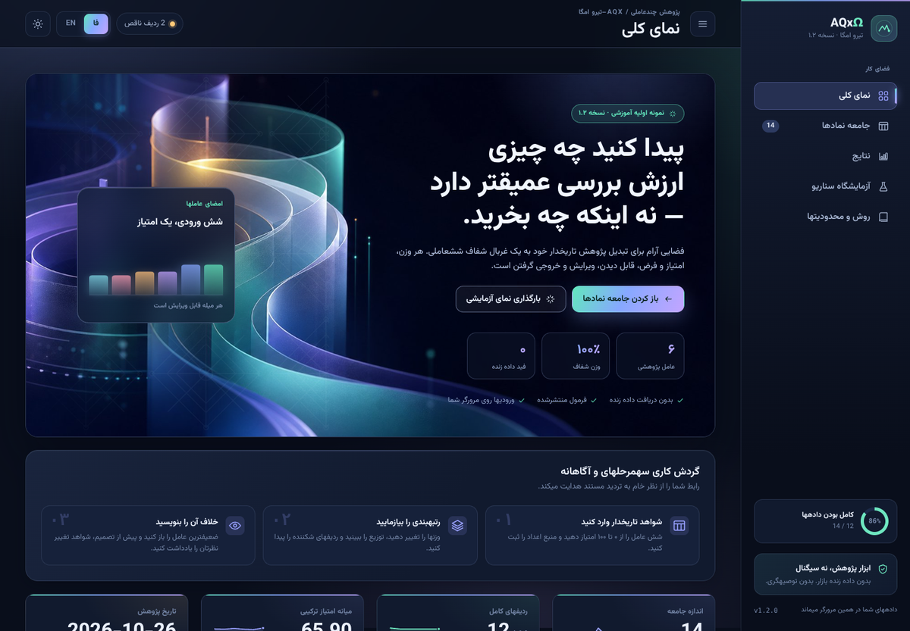

# AQx–Tirole Omega v1.2



این بسته نمونه اولیه آموزشی برای غربالگری چندعاملی است. داده زنده بورس ایران در آن وجود ندارد و رتبهبندی واقعی نمادها تولید نمیکند. نسخه ۱٫۲ علاوه بر خط فرمان، **رابط وب دوزبانه فارسی/انگلیسی** دارد.

> **هشدار:** هیچیک از خروجیها توصیه سرمایهگذاری، سیگنال خرید و فروش یا احتمال واقعی سود و زیان نیست. همه امتیازها را کاربر وارد میکند.

## رابط گرافیکی (نسخه ۱٫۲)

### اجرا

```bash
python -m venv .venv
source .venv/bin/activate
pip install -r requirements.txt
python app.py        # http://localhost:5000
```

سپس نشانی `http://localhost:5000` را در مرورگر باز کنید. رابط با دادههای **ساختگی DEMO** آغاز میشود تا بتوانید بخشها را ببینید؛ برای کار واقعی، امتیازهای تاریخدار خود را وارد کنید، فایل CSV بارگذاری کنید یا فهرست خالی نمادها را انتخاب کنید.

### بخشها

| بخش | کاربرد |
| --- | --- |
| نمای کلی | کارتهای شاخص، نمودار ردیفهای برتر، حلقه کامل بودن دادهها، پوشش عاملها، خلاصه وزنها و هشدارها |
| جامعه نمادها | جدول ویرایش امتیازها (۰ تا ۱۰۰)، شش اسلایدر وزن، تاریخ پژوهش و منبع داده، ورود/خروجی CSV، قالب نمونه و بارگذاری مجموعه داده |
| نتایج | هیستوگرام توزیع امتیازها، ردههای تفسیر، فهرست رتبهبندی قابل جستجو و فیلتر، **آزمون حساسیت وزنها** و کشوی جزئیات هر نماد (رادار، سهم عاملها، ضعیفترین ورودی، یادداشت شواهد مخالف) |
| آزمایشگاه سناریو | شبیهسازی مونتکارلو با نمودار کامل توزیع، صدکهای ۵/۵۰/۹۵، VaR و CVaR، فراوانی زیان و جدول حساسیت به نوسان. فرضها بهروشنی از پیشبینی جدا شدهاند |
| روش و محدودیتها | فرمول، تعریف عاملها همراه پرسشهای ضدسوگیری، محدودیتها، اصول طراحی و دسترسیپذیری، و دستور خط فرمان |

### ویژگیهای رابط

- **فارسی بهعنوان زبان پیشفرض:** رابط بهطور پیشفرض فارسی و راستبهچپ بارگذاری میشود. کلید `فا | EN` زبان را تغییر میدهد و انتخاب شما را به خاطر میسپارد. چیدمان، برچسبها و نمودارها جهت میگیرند و اعداد برای خوانایی چپبهچپ میمانند.
- **هویت بصری قویتر:** فونت متغیر وزیرمتن (همراه فونت لاتین Plus Jakarta Sans) بهصورت محلی و بدون CDN، پالت رنگی ششعامل، تصویرسازی aurora در بخش آغازین با نقش هندسی ایرانی، کارتهای شیشهای، نمودارهای گرادیانی و انیمیشن ملایم.
- **تم تاریک بهعنوان پیشفرض** و امکان تغییر به تم روشن با یک کلیک؛ انتخاب شما ذخیره میشود. بخش آغازین در هر دو تم تاریک میماند تا هویت بصری یکپارچه بماند.
- **کاملاً واکنشگرا:** از نوار کناری ثابت در دسکتاپ تا منوی کشویی در موبایل؛ جدول امتیازها در صفحههای کوچک به کارت تبدیل میشود.
- **بدون وابستگی خارجی:** بدون CDN، فونت خارجی، کتابخانه نمودار یا ردیاب. نمودارها SVG خالصاند.
- **حریم خصوصی:** ردیفها فقط در `localStorage` مرورگر ذخیره میشوند؛ هیچ پایگاه داده یا حساب کاربری وجود ندارد.
- **محاسبه خودکار با تأخیر:** هنگام تایپ، جدول بازترسیم نمیشود و تمرکز صفحهکلید از بین نمیرود.

توضیح کامل سیستم طراحی و منطق روانشناختی در فایل `DESIGN.md` و مستندات انگلیسی در `README.md` آمده است.

### قالب ورودی

```csv
ticker,competition,valuation,earnings_quality,growth,market_momentum,risk_control,note
EXAMPLE_ONLY,70,65,75,60,55,60,Illustrative only
YOUR_TICKER,,,,,,,
```

خانه خالی یعنی **شواهد ناقص**، نه صفر. برای ردیف ناقص هیچ امتیاز ترکیبی محاسبه نمیشود. ورودیها با سرستون فارسی، BOM، ارقام فارسی و جداکنندههای مختلف نیز پذیرفته میشوند. فایل `iran_universe_blank.csv` فهرستی از نمادهای نمونه با امتیازهای خالی است و `data/illustrative_demo.csv` داده کاملاً ساختگی برای آشنایی با رابط است.

### API محلی

`GET /api/meta`، `GET /api/datasets`، `POST /api/score`، `POST /api/simulate`، `POST /api/import`، `GET /api/template.csv`، `POST /api/export`، `GET /api/health`. جزئیات در `README.md`.

### آزمونها

```bash
pip install pytest
pytest -q
```

---

## عوامل و وزنها
- قدرت رقابتی: 25%
- جذابیت ارزشگذاری: 25%
- کیفیت سود: 15%
- ظرفیت رشد: 15%
- مومنتوم بازار: 10%
- کنترل ریسک: 10%

امتیازها باید بین صفر تا 100 باشند. اگر یکی از عوامل خالی باشد، امتیاز نهایی محاسبه نمیشود تا داده ناقص رتبهبندی کاذب نسازد. وزنها قابل ویرایشاند و پیش از محاسبه به ۱۰۰٪ نرمال میشوند؛ وزنهای اعمالشده در نتایج و فایل خروجی گزارش میشود.

## اجرای خط فرمان (همچنان پابرجاست)
نیازمند Python و کتابخانههای `pandas` و `numpy`:
```bash
pip install pandas numpy
python aqx_tirole_omega.py --input universe_input.csv --output aqx_ranked_output.csv
```
فایل `universe_input_template.csv` فقط قالب نمونه است؛ EXAMPLE_ONLY نماد واقعی نیست. فایل `iran_universe_blank.csv` فهرستی از نمادهای نمونه برای ورود داده دارد و امتیازهای آن عمداً خالی است. لایه وب همان توابع امتیازدهی و شبیهسازی را وارد میکند و پیادهسازی دومی از ریاضیات وجود ندارد.

## مونتکارلو
تابع `monte_carlo_terminal_values` سناریوهای فرضی بازده و نوسان را شبیهسازی میکند. تا وقتی پارامترها از داده معتبر و آزمون تاریخی کالیبره نشدهاند، خروجی آن احتمال واقعی رشد یا زیان سهم نیست.

## محدودیتها
- دریافت خودکار دادههای بازار یا کدال پیادهسازی نشده است.
- ارزشگذاری بنیادی به دادههای مالی معتبر و تاریخدار نیاز دارد.
- افزایش سرمایه بهتنهایی خلق ارزش نیست؛ محل افزایش سرمایه، رقیقشدن مالکیت و تغییر سودآوری باید جداگانه بررسی شود.
- امتیاز غربالگری سیگنال خرید/فروش یا تضمین بازده نیست.
